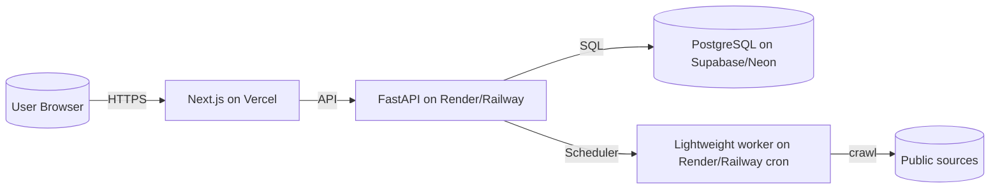

# Architecture Diagram

## 1. High-Level System Architecture (Mermaid)

```mermaid
flowchart TD
    subgraph Sources["Public Hiring Sources"]
        S1[Company Career Pages]
        S2[ATS: Greenhouse/Lever/Ashby/SmartRecruiters/Workday]
        S3[LinkedIn posts]
        S4[X/Twitter posts]
        S5[Instagram posts/reels]
        S6[Reddit communities]
        S7[Telegram channels]
        S8[Discord communities]
        S9[Startup boards / founder announcements]
        S10[Other public sources]
    end

    subgraph Discovery["Discovery Layer (Adapters)"]
        D1[Company Career Page Adapter]
        D2[ATS Adapters x N]
        D3[LinkedIn Adapter]
        D4[X Adapter]
        D5[Instagram Adapter]
        D6[Reddit Adapter]
        D7[Telegram Adapter]
        D8[Discord Adapter]
        D9[Startup Board Adapter]
        D10[Generic Source Adapter]
    end

    subgraph Ingest["Ingest & Normalize (FastAPI)"]
        I1[Ingest API / Webhooks]
        I2[Raw Opportunity Queue]
        I3[Normalizer -> Canonical Schema]
    end

    subgraph Verify["Verification Layer"]
        V1[Employer Verification Service]
        V2[Active-Opening Checker]
        V3[Verification Signals Store]
    end

    subgraph Enrich["Enrichment Layer"]
        E1[Stipend Extractor]
        E2[Duration Extractor]
        E3[Location Extractor]
        E4[Eligibility Extractor]
        E5[Enriched Profile Store]
    end

    subgraph Rank["Ranking Layer"]
        R1[Scoring Engine]
        R2[Ranked Opportunity Store]
    end

    subgraph Monitor["Monitoring Layer"]
        M1[Scheduler / Worker]
        M2[Re-check Jobs]
        M3[Status Transition Tracker]
    end

    subgraph Data["Data Layer (PostgreSQL)"]
        DB1[(opportunities)]
        DB2[(source_runs)]
        DB3[(verifications)]
        DB4[(enrichments)]
        DB5[(rankings)]
        DB6[(monitoring_history)]
        DB7[(users, alerts)]
    end

    subgraph Frontend["Frontend (Next.js + Tailwind)"]
        F1[Opportunity Dashboard]
        F2[Search & Filters]
        F3[Detail View]
        F4[Alerts / Subscriptions]
    end

    Sources --> Discovery
    Discovery --> Ingest
    Ingest --> Verify
    Verify --> Enrich
    Enrich --> Rank
    Rank --> Monitor
    Monitor --> Data
    Data <--> Frontend

    style Sources fill:#f9f,stroke:#333,stroke-width:2px
    style Discovery fill:#bbf,stroke:#333,stroke-width:2px
    style Verify fill:#f9f,stroke:#333,stroke-width:2px
    style Enrich fill:#bfb,stroke:#333,stroke-width:2px
    style Rank fill:#fbf,stroke:#333,stroke-width:2px
    style Monitor fill:#ffd,stroke:#333,stroke-width:2px
    style Data fill:#ddd,stroke:#333,stroke-width:2px
    style Frontend fill:#dfd,stroke:#333,stroke-width:2px
```



## 2. Layer Responsibilities

| Layer | Responsibility | Core Concern |
|-------|---------------|--------------|
| **Sources** | Public data origins | Read-only access to public pages/posts |
| **Discovery** | Find potential opportunities | One adapter per source; produce raw candidates |
| **Ingest** | Receive & normalize raw candidates | Canonical schema, dedupe, source-run tracking |
| **Verification** | Confirm employer has an active opening | Cross-check career page/ATS; store verification signals |
| **Enrichment** | Collect stipend, duration, location, eligibility | Field extraction from raw text/HTML |
| **Ranking** | Score & order opportunities | Relevance, recency, stipend, employer brand, India-remote fit |
| **Monitoring** | Re-check active status over time | Scheduler, status transitions, stale-opportunity cleanup |
| **Data** | Persistent store | PostgreSQL + SQLAlchemy + Alembic |
| **Frontend** | User interface | Next.js + Tailwind; search, filters, detail, alerts |

## 3. Separation of Concerns (Critical Requirement)

The five concepts are **decoupled services**, not a single monolithic pipeline:

```
Discovery  -->  Verification  -->  Enrichment  -->  Ranking  -->  Monitoring
   (find)        (confirm)        (collect)     (score)      (watch)
```

Each layer owns its own table(s), its own adapter/service class, and its own failure handling. A failure in enrichment must not block ranking; a failed verification must not delete the discovered opportunity.

## 4. Adapter Contract (Every Source Gets Its Own Adapter)

```text
Adapter interface (Python):
  - discover() -> list[RawOpportunity]
  - extract_enrichment(raw) -> EnrichmentFields   (optional, source-specific hints)
  - verify(opportunity) -> VerificationResult    (optional, source-specific signal)
```

Adapters live under `backend/adapters/<source>/`. Common crawl utilities (httpx, BeautifulSoup, Playwright) live under `backend/crawling/`.

## 5. Data Flow (End-to-End Example)

1. Scheduler triggers the Greenhouse adapter for a target company.
2. Adapter fetches the public Greenhouse job board, parses `jobs/` JSON/HTML.
3. Each job becomes a `RawOpportunity` and is pushed to the ingest queue.
4. Ingest normalizes into the canonical `opportunity` schema; dedupes by `source + external_id`.
5. Verification service re-fetches the company career page to confirm the opening is still active.
6. Enrichment service parses stipend/duration/location/eligibility from the job description.
7. Ranking engine computes a score and stores it.
8. Monitoring schedules a re-check in N hours/days.
9. Frontend queries ranked, verified, enriched opportunities via the FastAPI REST API.

## 6. Deployment Topology (Free-Tier Friendly)


