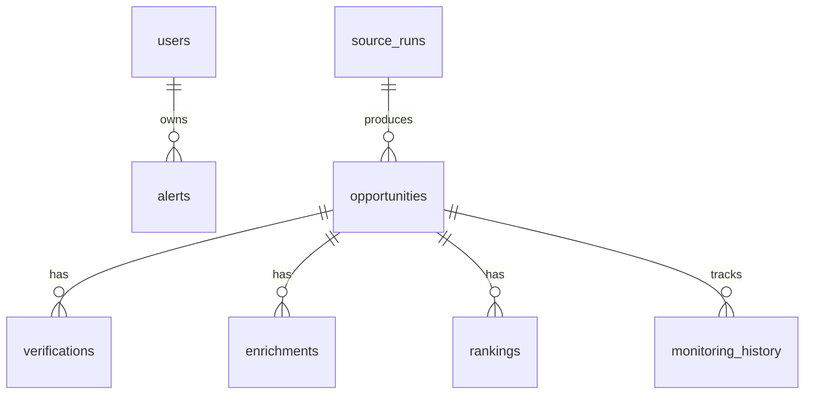

# Database Design Proposal

## 1. Design Principles

- **One source of truth**: PostgreSQL is the single system of record for opportunities, verification state, enrichment, ranking, and monitoring history.
- **Immutable raw capture**: Raw HTML/JSON fetched from sources is stored as-is before normalization, so re-processing is possible without re-crawling.
- **Soft deletes**: Opportunities are never hard-deleted; they transition through statuses (`discovered` -> `verified` / `rejected` -> `monitored` -> `expired`).
- **Separation of concerns**: Each of discovery, verification, enrichment, ranking, and monitoring has its own table(s). A failure in one layer does not cascade-delete data from another.
- **Auditability**: Every row has `created_at` and `updated_at`; source runs are recorded so we know when and how each opportunity was last touched.

## 2. Schema Overview (SQLAlchemy / Alembic)

### Core Tables

```
users
├── id (PK, uuid)
├── email (unique, indexed)
├── password_hash
├── role (enum: free, pro, admin)
├── created_at
└── updated_at

opportunities
├── id (PK, uuid)
├── source (varchar, indexed)            -- e.g. 'greenhouse', 'linkedin', 'company_page'
├── source_id (varchar, indexed)        -- external id from the source
├── source_url (text)                   -- canonical public URL
├── title (varchar)
├── company (varchar, indexed)
├── company_url (text)
├── description_raw (text)              -- raw captured description
├── location (varchar)                  -- e.g. 'Remote, India', 'Bengaluru, India'
├── is_remote (boolean)
├── is_paid (boolean)
├── stipend_min (numeric)
├── stipend_max (numeric)
├── stipend_currency (varchar, default 'INR')
├── duration_min_months (integer)
├── duration_max_months (integer)
├── eligibility (text)                  -- e.g. 'B.Tech/MCA, 2025 batch'
├── application_url (text)
├── application_email (text)
├── status (varchar, indexed)           -- discovered, verified, rejected, monitored, expired
├── verification_status (varchar)       -- pending, verified, unverified, expired
├── verification_evidence (jsonb)       -- screenshot URL, matched text, timestamps
├── rank_score (numeric, indexed)       -- computed ranking score
├── rank_factors (jsonb)                -- breakdown of score factors
├── discovered_at (timestamp)
├── verified_at (timestamp)
├── expires_at (timestamp)
├── created_at (timestamp)
└── updated_at (timestamp)
├── unique (source, source_id)
├── index (company)
└── index (status, is_remote, is_paid)

source_runs
├── id (PK, uuid)
├── source (varchar, indexed)
├── adapter_name (varchar)
├── started_at (timestamp)
├── finished_at (timestamp)
├── status (varchar)                    -- running, completed, failed
├── opportunities_found (integer)
├── opportunities_new (integer)
├── opportunities_updated (integer)
├── error_message (text)
└── created_at (timestamp)

## 3. Entity Relationship Summary



## 4. Status Lifecycle (Opportunity)

```
discovered
   | (verified by verification layer)
   v
verified  ----\
   |           \
   v            \
monitored <------+  (re-check finds still active)
   | (re-check finds inactive/expired)
   v
expired

rejected  (verification failed or not a real internship)
```

## 5. Indexing Strategy (for query performance)

| Table | Column(s) | Reason |
|-------|-----------|--------|
| `opportunities` | `(source, source_id)` unique | Dedupe per source |
| `opportunities` | `status` | Filter dashboard by status |
| `opportunities` | `is_remote, is_paid` | Core search filters |
| `opportunities` | `company` | Company search |
| `opportunities` | `rank_score DESC` | Ranked listing |
| `opportunities` | `discovered_at` | Recent listings |
| `verifications` | `opportunity_id` | Lookup verification history |
| `enrichments` | `opportunity_id` | Join enrichment to opportunity |
| `rankings` | `opportunity_id` | Join ranking to opportunity |
| `monitoring_history` | `opportunity_id` | Audit status transitions |
| `alerts` | `user_id` | Per-user alerts |
| `source_runs` | `source, started_at` | Run audit per source |

## 6. Migration Strategy (Alembic)

- Initial migration: `alembic init alembic`, then generate the full schema in one revision (`001_initial_schema`).
- Future changes via `alembic revision --autogenerate`.
- Each migration reviewed before applying to production (free-tier DBs often have limited connection pools; avoid long-locking operations).

## 7. Free-Tier Database Options

| Provider | Free Tier | Notes |
|----------|-----------|-------|
| Supabase | 500 MB DB, 2 projects | PostgreSQL, built-in auth, good free tier |
| Neon | 0.5 GB storage, auto-suspend | PostgreSQL, serverless, branches |
| Railway | $5 trial credit, then paid | Not truly free long-term |
| Render | 90-day disk (ephemeral) | Not suitable for persistent DB |
| ElephantSQL | 20 MB (discontinued-ish) | Avoid |

Recommendation: **Supabase** or **Neon** for the free-tier PostgreSQL. Both offer managed PostgreSQL with generous free tiers suitable for an MVP.

## 8. Assumptions & Limitations

- All monetary values stored in minor currency units? For simplicity, stipend stored as decimal with `stipend_currency` (INR default).
- `jsonb` used for evidence, factors, and eligibility to allow schema evolution without migrations.
- No full-text search index initially; ILIKE or application-side filtering used for MVP. PostgreSQL `tsvector` can be added later if search latency becomes an issue.


verifications
├── id (PK, uuid)
├── opportunity_id (FK -> opportunities.id, indexed)
├── checked_at (timestamp)
├── is_active (boolean)
├── evidence (jsonb)
├── method (varchar)                    -- 'career_page', 'ats_direct', 'email_confirm'
└── created_at (timestamp)

enrichments
├── id (PK, uuid)
├── opportunity_id (FK -> opportunities.id, indexed)
├── field (varchar)                     -- 'stipend', 'duration', 'location', 'eligibility'
├── value (text)
├── confidence (numeric)                -- 0.0 - 1.0
├── source_snippet (text)
├── extracted_at (timestamp)
└── created_at (timestamp)

rankings
├── id (PK, uuid)
├── opportunity_id (FK -> opportunities.id, indexed)
├── score (numeric)
├── factors (jsonb)                     -- e.g. {stipend: 30, recency: 20, employer_brand: 25, india_remote: 25}
├── ranked_at (timestamp)
└── created_at (timestamp)

monitoring_history
├── id (PK, uuid)
├── opportunity_id (FK -> opportunities.id, indexed)
├── checked_at (timestamp)
├── status_before (varchar)
├── status_after (varchar)
├── change_reason (varchar)
└── created_at (timestamp)

alerts
├── id (PK, uuid)
├── user_id (FK -> users.id, indexed)
├── query (jsonb)                       -- saved search filters (keywords, location, stipend_min)
├── channel (varchar)                   -- 'email', 'webhook'
├── is_active (boolean)
├── last_sent_at (timestamp)
└── created_at (timestamp)